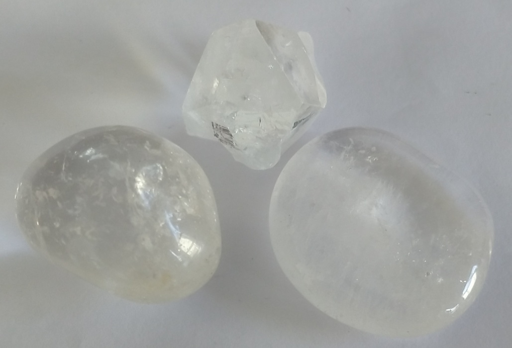
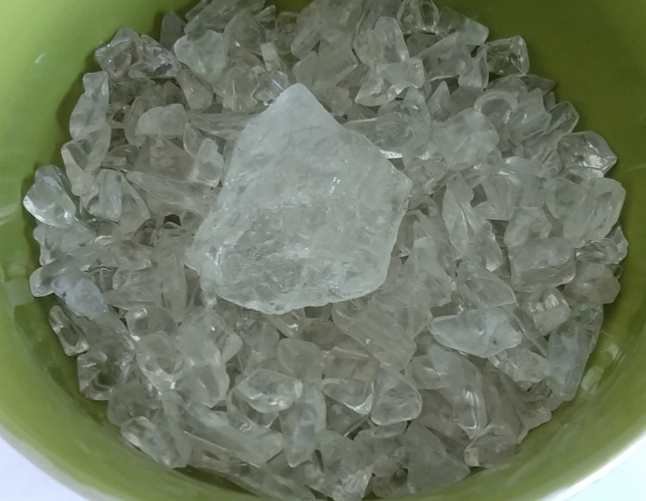

## Description
Cristaux en vrac pour la recharge, cristal brut pour la recharge et pierres polies.

{.align-center}

{.align-center}

{.align-center}

## Propriétés sur le corps physique

Les sources divergent sur le corps physique. Deux d'entre elles lui attribuent surtout un effet sur le stress et les tensions, et l'une cite la circulation des fluides corporels ; une autre lui prête des soutiens plus larges (douleurs, yeux, oreilles, système nerveux). La troisième indique qu'il agit avant tout sur le plan spirituel et mental et ne décrit aucun bienfait corporel précis.

Sources : [Lithothérapie.net](https://www.lithotherapie.net/articles/cristal-de-roche-quartz/), [Camille Ambiance Nature](https://camille-ambiance-nature.fr/pierre/cristal-de-roche), [Pierres-lithothérapie.com](https://www.pierres-lithotherapie.com/cristal-de-roche-proprietes/)

## Propriétés sur le psychisme

Les sources le décrivent comme une pierre d'ouverture d'esprit : méditation et concentration (deux sources), réceptivité aux idées nouvelles (deux sources). Deux d'entre elles ajoutent qu'il aiderait à canaliser les énergies et à s'exprimer, avec un effet apaisant sur l'anxiété. Une source avertit qu'il peut provoquer une sensation d'euphorie ou de déséquilibre et le déconseille en cas de troubles mentaux ou de sensibilité déjà très forte.

Sources : [Lithothérapie.net](https://www.lithotherapie.net/articles/cristal-de-roche-quartz/), [Camille Ambiance Nature](https://camille-ambiance-nature.fr/pierre/cristal-de-roche), [Pierres-lithothérapie.com](https://www.pierres-lithotherapie.com/cristal-de-roche-proprietes/)

## Acquisition
Kerstin S., Perroy, 24.05.2020
