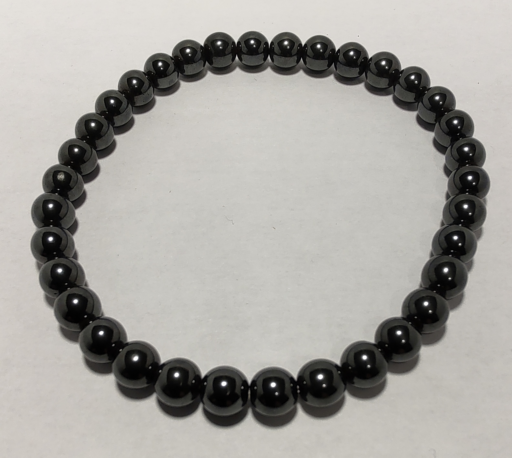

## Description
Description.

{.align-center}
1. {.align-center}

## Propriétés sur le corps physique

L'hématite, riche en fer, est avant tout liée au sang : on l'associe à l'anémie et au manque de fer, à la circulation (jambes, veines) et à la lutte contre la fatigue. Les sources mentionnent aussi des crampes, un effet régulateur sur le cycle menstruel, des maux de tête, la tension artérielle, le foie et les reins, ainsi que la cicatrisation et la résorption des hématomes.

Sources : [lithotherapie.net](https://www.lithotherapie.net/articles/hematite/), [pierres-lithotherapie.com](https://www.pierres-lithotherapie.com/hematite-proprietes/), [camille-ambiance-nature.fr](https://camille-ambiance-nature.fr/pierre/hematite)

## Propriétés sur le psychisme

Les trois sources s'accordent sur une pierre qui donne du courage et de la confiance en soi, atténue la timidité et le doute, et développe l'écoute de soi et des autres ainsi que la patience. On lui attribue aussi un rôle pour sortir des addictions et des comportements compulsifs, calmer la colère, le stress et les peurs, favoriser le sommeil, et stimuler la concentration et la mémoire. Une source la dit aussi « ancrante » pour les personnes trop rêveuses.

Sources : [lithotherapie.net](https://www.lithotherapie.net/articles/hematite/), [pierres-lithotherapie.com](https://www.pierres-lithotherapie.com/hematite-proprietes/), [camille-ambiance-nature.fr](https://camille-ambiance-nature.fr/pierre/hematite)

## Acquisition
1. Kerstin S., Perroy, 24.05.2020
1. Zünd Event-Glasbläserei Heilstein-Atelier, Lamboing, 11.02.2023
