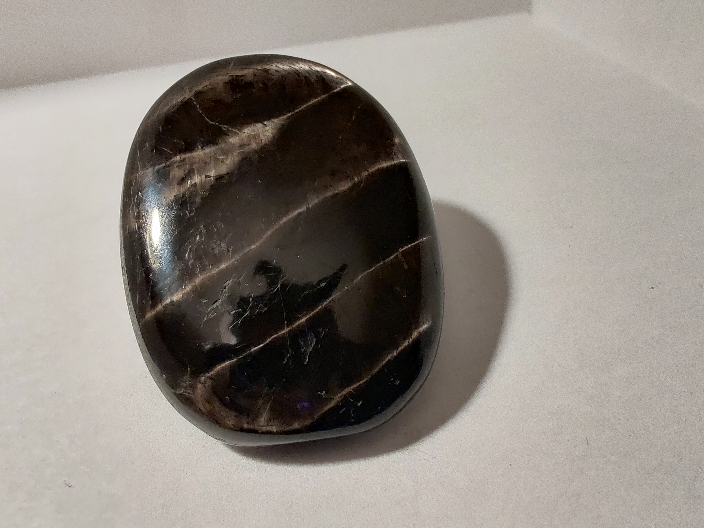
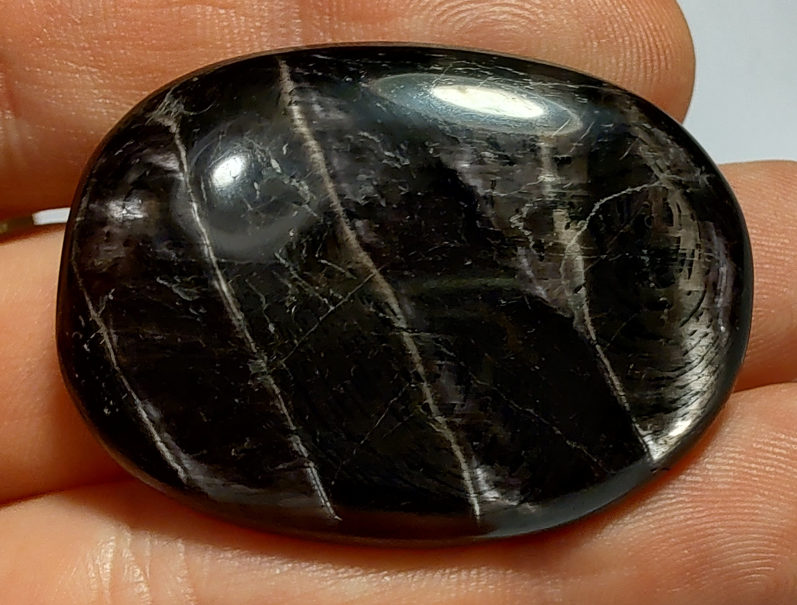
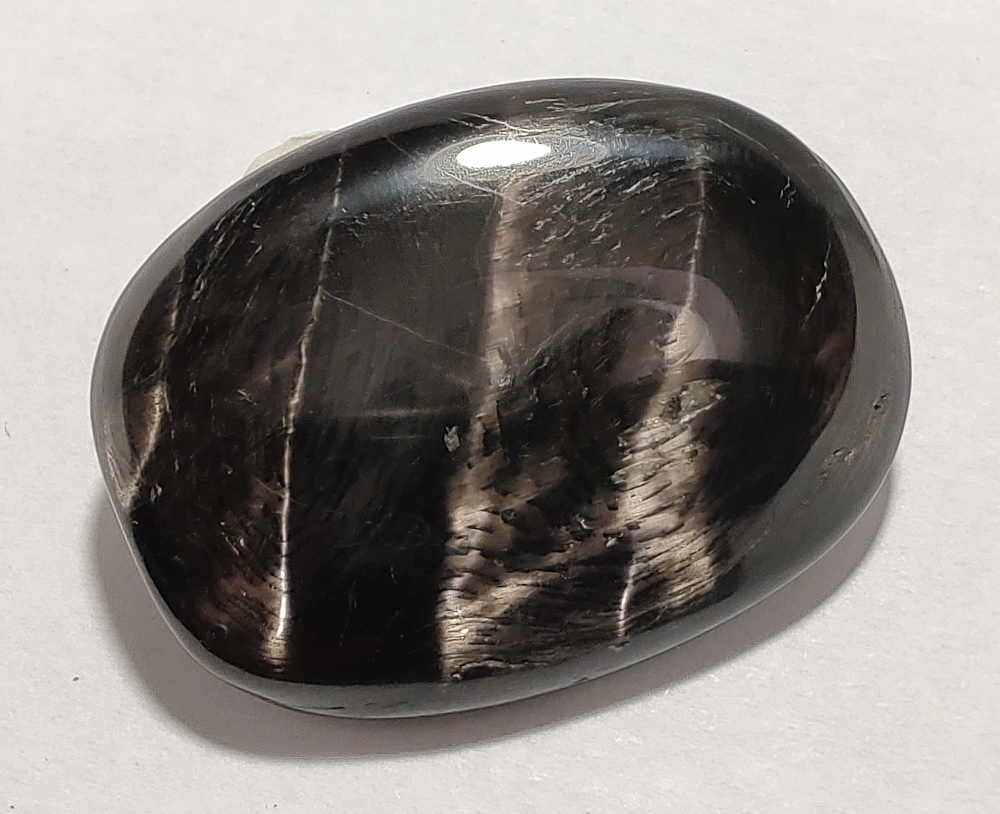
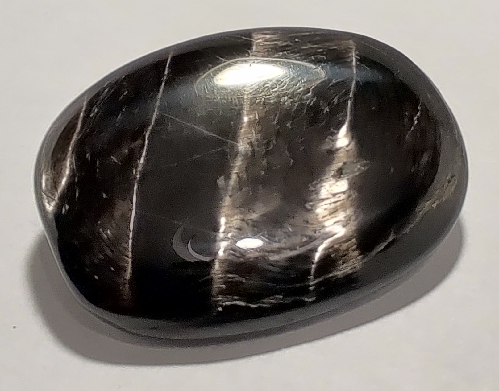

## description
Très sombre avec reflets alternatifs dans la lumière.

{.align-center}

{.align-center}

{.align-center}

{.align-center}

{.align-center}

## Propriétés sur le corps physique

Les deux sources associent l'hypersthène à la réduction du stress, à l'énergie et à la vitalité, et à une lutte contre la fatigue. Les autres points ne sont cités que par une source.

Sources : [Camille Ambiance Nature](https://camille-ambiance-nature.fr/pierre/hypersthene), [Le Comptoir Géologique](https://www.le-comptoir-geologique.com/lithotherapie-hyperstene.html)

## Propriétés sur le psychisme

Elles divergent : une source mentionne l'ancrage, la protection psychique, l'empathie, l'apaisement de la colère et de l'anxiété, la confiance en soi et l'introspection ; l'autre la méditation et la clairvoyance.

Sources : [Camille Ambiance Nature](https://camille-ambiance-nature.fr/pierre/hypersthene), [Le Comptoir Géologique](https://www.le-comptoir-geologique.com/lithotherapie-hyperstene.html)

## Acquisition
L'Âge de Pierre, Vevey, 03.11.2020
