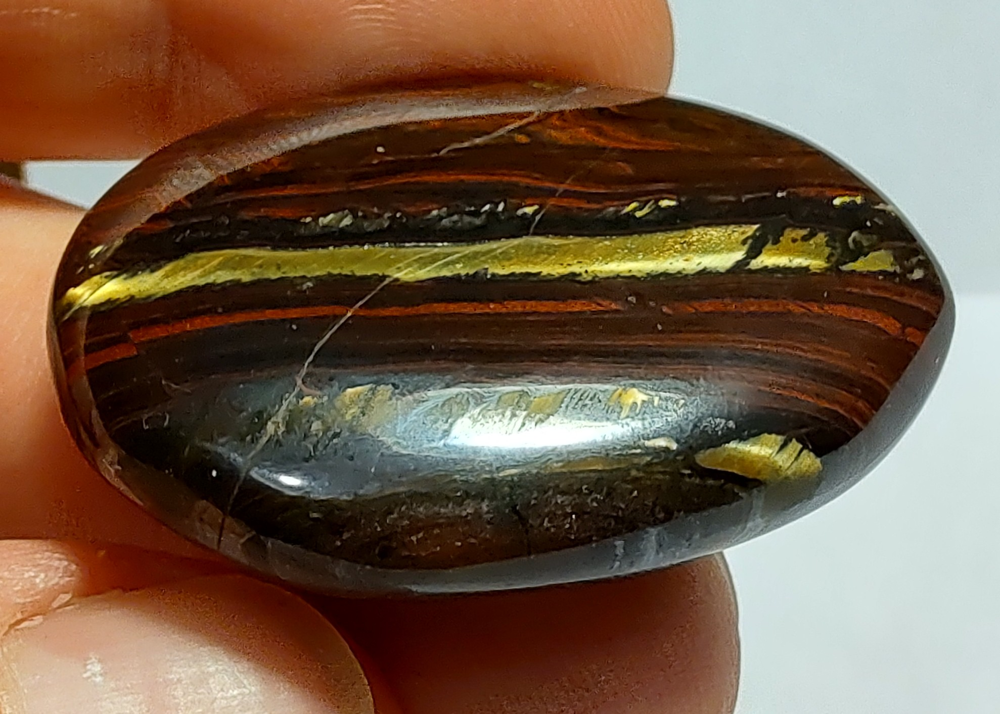
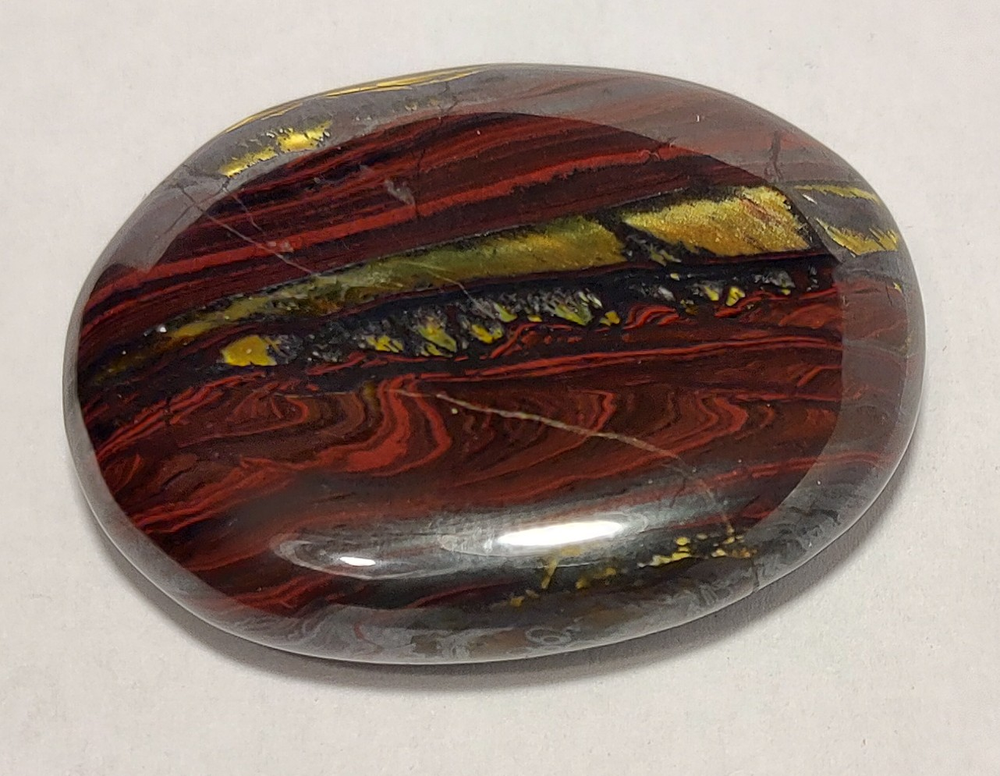

## description
Rouge foncée voire brune avec une veine dorée qui s'illumine à la lumière.

{.align-center}

{.align-center}

{.align-center}

## Propriétés sur le corps physique

Les deux sources divergent sur le corps physique. Elles associent la pierre à la vitalité et à l'énergie, mais l'une met en avant la réduction du stress et la circulation des fluides, l'autre un soutien du système respiratoire, digestif et de la vue. Les affirmations de l'une sur les maladies chroniques sont omises.

Sources : [Camille Ambiance Nature](https://camille-ambiance-nature.fr/pierre/oeil-de-fer), [Le Comptoir Géologique](https://www.le-comptoir-geologique.com/lithotherapie-oeil-de-fer.html)

## Propriétés sur le psychisme

Les deux sources s'accordent sur la concentration et la protection contre les influences négatives de l'entourage. L'une ajoute l'optimisme, l'assurance, l'ancrage et la mémoire ; l'autre la clarté des intentions et l'énergie mentale.

Sources : [Camille Ambiance Nature](https://camille-ambiance-nature.fr/pierre/oeil-de-fer), [Le Comptoir Géologique](https://www.le-comptoir-geologique.com/lithotherapie-oeil-de-fer.html)

## Acquisition
L'Âge de Pierre, Vevey, 03.11.2020
