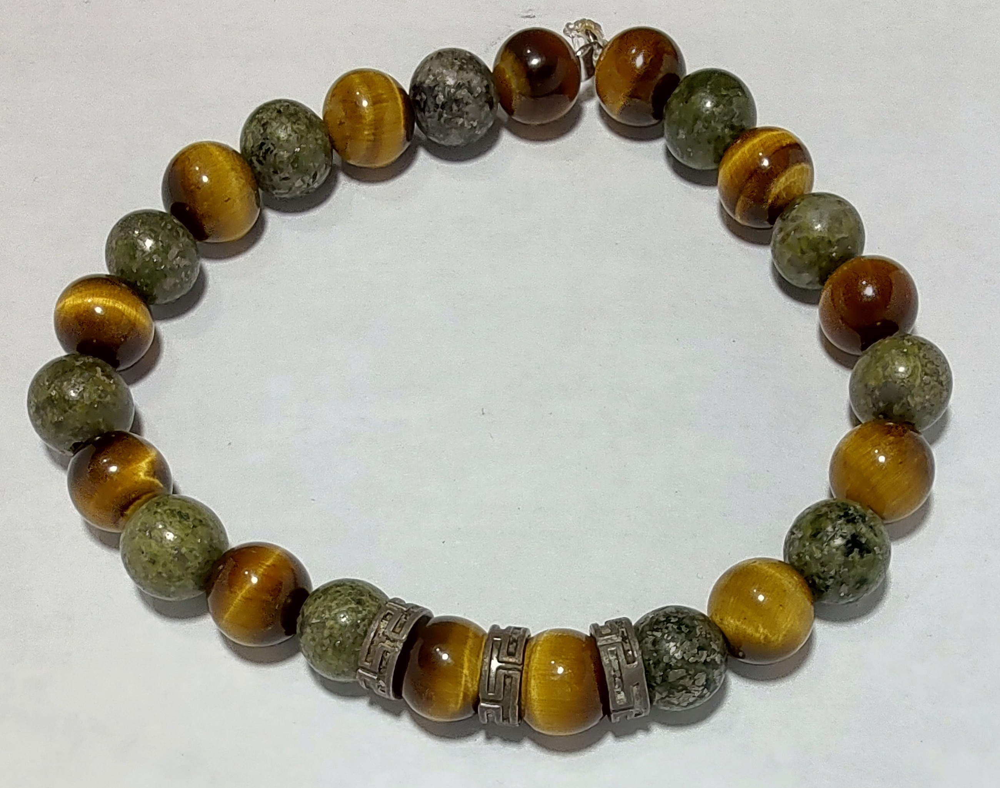

## Description
Bracelet alternant des perles de oeil de tigre avec des perles de serpentine.

Le bracelet s'est cassé dans un train en Indonésie à force de le mettre et le retirer.
J'ai pu récupérer presque toutes les perles. Les autres ont quitté le train par le trou 
dans les WC's.

{.align-center}

{.align-center}

## Propriétés sur le corps physique

[Source](https://)

## Propriétés sur le psychisme

[Source](https://)

## Acquisition
Gwendoline D., Nyon, unknown date
